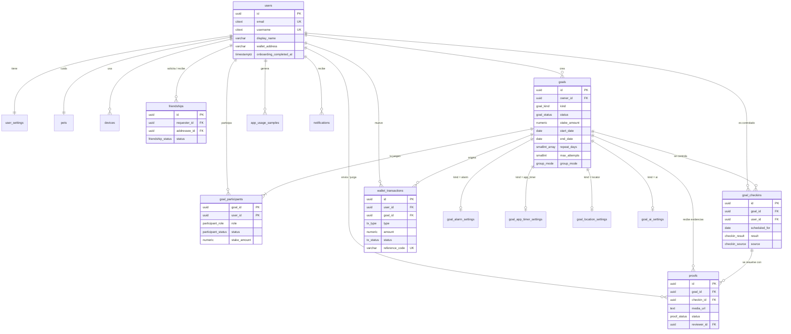
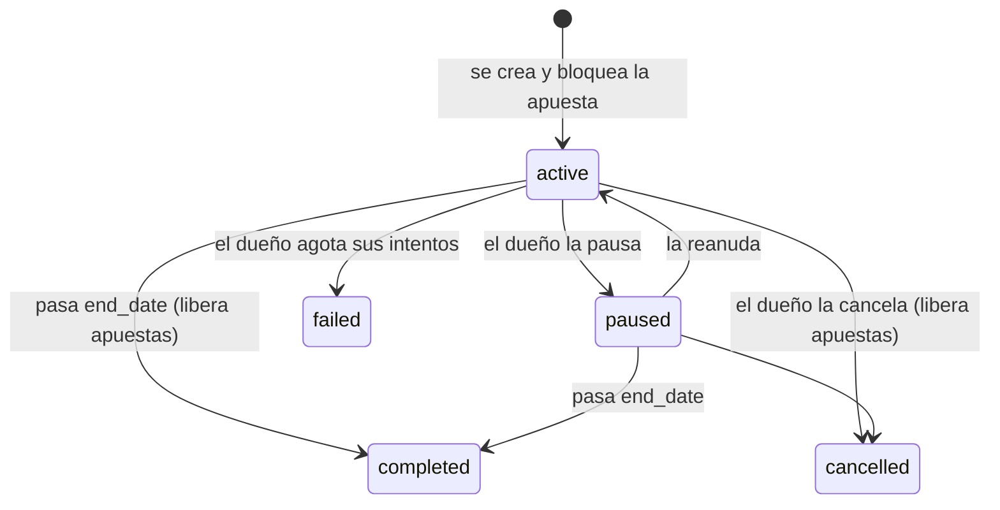
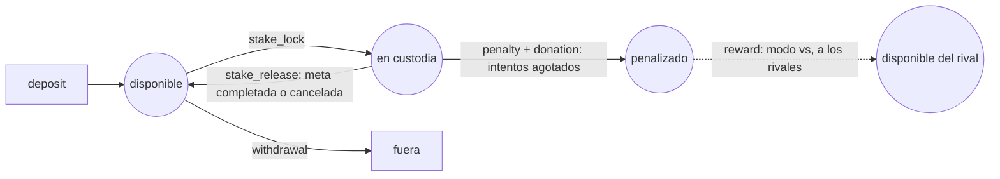

# Modelo entidad-relación · WillFolks

Diagrama en Mermaid (GitHub, VS Code y la mayoría de visores de Markdown lo renderizan).
El detalle de cada columna está en el [diccionario de datos](diccionario-de-datos.md) y el
mismo modelo en formato DBML en [`willfolks.dbml`](willfolks.dbml).

## Decisiones de diseño

| Decisión | Motivo |
| --- | --- |
| Una tabla `goals` y cuatro `goal_*_settings` 1:1 | Lo común (apuesta, fechas, días, intentos) se consulta igual para todos los tipos; lo específico queda tipado y con sus propios `CHECK`, sin columnas nulas ni un `jsonb` opaco. |
| Saldos derivados de `wallet_transactions` (vista `v_user_balances`) | No hay un saldo guardado que pueda desincronizarse: cada número se puede auditar sumando movimientos. |
| `amount` siempre positivo y el signo en `type` | Evita errores de signo y permite un `CHECK (amount > 0)` simple. |
| Único `(goal_id, user_id, scheduled_for)` en `goal_checkins` | Un veredicto por meta, usuario y día: reintentar desde el teléfono (sin red, doble toque) es idempotente. |
| `goal_participants.stake_amount` como "lo que sigue en custodia" | Al penalizar o liberar pasa a 0, así nunca se devuelve dos veces una apuesta. |
| Índice único sobre `LEAST/GREATEST` en `friendships` | Una sola fila por pareja sin importar quién envió la solicitud. |
| `ON DELETE CASCADE` desde `users` | Borrar la cuenta (RNF-30) elimina todo lo personal en una sola operación. |
| `verifier_user_id` con `ON DELETE SET NULL` y sin `CHECK` | Si el amigo juez borra su cuenta, la meta sigue viva y vuelve a juzgar la IA. |

## Estados

**Meta (`goal_status`)**

**Dinero de una apuesta (`tx_type`)**

